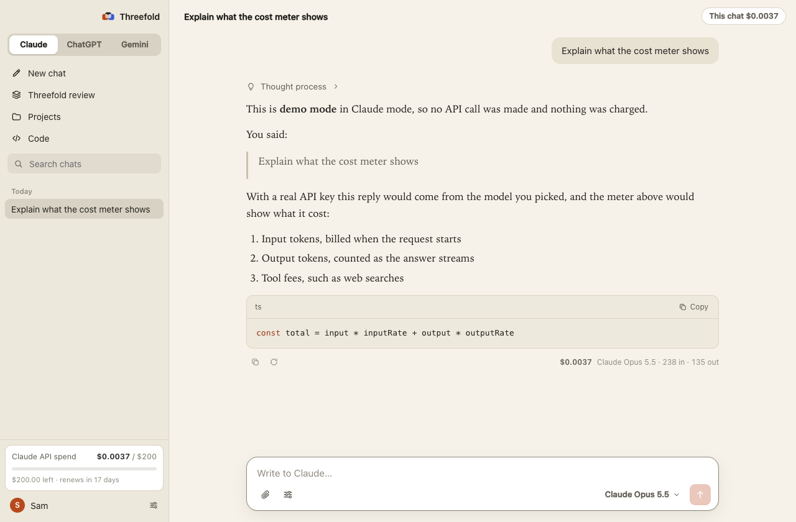
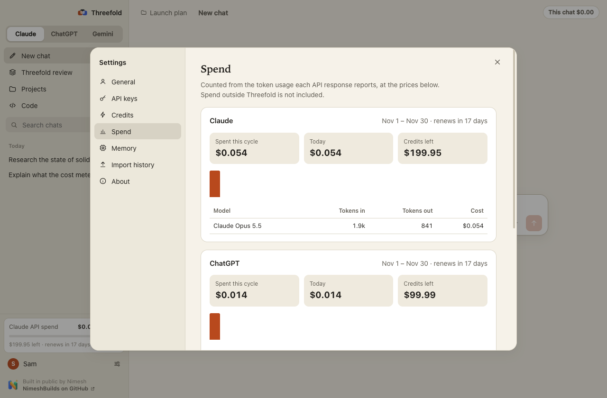

<p align="center"></p>

# Threefold

**Three assistants. One local app. Your own API credits.**

Threefold is a desktop app for macOS with a Claude mode, a ChatGPT mode and a Gemini mode. It talks to the Anthropic, OpenAI and Google APIs directly from your computer with your own API keys, and it shows what every message costs while the reply is still being written.

It exists because paid Claude, ChatGPT and Google AI plans now include monthly API credits that the official apps cannot spend. Threefold gives those credits somewhere to go.

[Website](https://nimeshbuilds.github.io/threefold/) · Built in public by Nimesh under [NimeshBuilds](https://github.com/nimeshbuilds)

> Threefold is an independent project. It is not made by, affiliated with or endorsed by Anthropic, OpenAI or Google. "Claude", "ChatGPT" and "Gemini" are trademarks of their owners and are used only to say which API a mode connects to.



## What it does

| | Claude mode | ChatGPT mode | Gemini mode |
|---|---|---|---|
| Chat with streaming, model picker, thinking | Yes | Yes | Yes |
| Images, PDFs and text files in a message | Yes | Yes | Yes |
| Web search | Yes, and it reads pages | Yes, and it reads pages | Yes (Google Search), and it reads pages |
| Code execution | Yes, with data files and charts | Yes, with data files and charts | Yes, CSV and TSV files only |
| Deep research | Yes | Yes | Yes (Google's Deep Research agent) |
| Image generation | No: Anthropic's API has no image model | Yes | Yes |
| Live preview panel for pages and SVGs | Yes | Yes | Yes |
| Projects (instructions and reference files) | Yes | Yes | Yes |
| Memory across chats, shared by every mode | Yes | Yes | Yes |
| Coding agent in a project folder | Claude Agent SDK | Threefold's own agent | Threefold's own agent |
| Import history from a data export | Yes | Yes | Activity log, grouped into chats |

| ChatGPT mode | Gemini mode |
|---|---|
|  |  |

Screenshots are from demo mode, which is why the replies describe themselves as canned.

### Threefold review

Once two or more providers are connected, the **Threefold review** tab turns on. You pick an answering model and up to four reviewers, from every provider you have a key for: with three keys you can answer with one and have the other two review, or any other mix. Each message then runs in three steps:

1. **Draft.** The answering model replies.
2. **Review.** Every reviewer reads the draft and lists what is wrong or missing. Reviews run at the same time.
3. **Final.** The answering model rewrites its reply with the reviews in hand.


Every step is a separate API request and **every model you pick bills you for its part**: the answering model twice, each reviewer once. The tab says so when it opens, names each provider, and lists the cost of every step under the answer. If a reviewer fails, the others are still used; if none comes back, you get the draft and are told it was not reviewed.

### Deep research

Switch on **Deep research** (the sliders button) for one message. The model plans its questions, searches widely, reads the sources and writes a cited report. It switches itself off after that message. Each provider's API does this differently, so each mode uses its provider's own route:

| Mode | How it runs | What to expect |
|---|---|---|
| Claude | The chat model at `xhigh` effort with web search and web fetch. Anthropic has no separate research endpoint. | Several minutes; many more tokens than a normal reply |
| ChatGPT | Your chosen model at `xhigh` reasoning effort with uncapped web search, in OpenAI's background mode. | Several minutes; OpenAI stores the response, because background mode requires it |
| Gemini | Google's Deep Research agent on the Interactions API. | Usually under 20 minutes; Google estimates $1 to $3 a run, and stores the run |

In **Threefold review**, deep research makes the draft a full research run. The reviewers may then search the web themselves to check the report's claims and sources, and the answering model rewrites it with their findings (with web search available, but not as a second research run).


### What each API offers, and what Threefold uses

Checked against each provider's documentation and SDK in November 2026.

| Capability | Anthropic | OpenAI | Google | In Threefold |
|---|---|---|---|---|
| Web search | Yes | Yes | Yes | All three modes |
| Open and read a web page | Web fetch | Part of web search | URL context | All three modes, with web search |
| Code execution sandbox | Yes | Code interpreter | Yes | All three modes |
| Deep research | No endpoint; done with the chat model | No dedicated model any more; done with a reasoning model in background mode | Deep Research agent | All three modes, and Threefold review |
| Image generation | No | Yes | Yes (Nano Banana) | ChatGPT and Gemini modes |
| Memory | Memory tool | No built-in | No built-in | Threefold's own, shared by every mode |
| Remote MCP connectors | Yes | Yes | Yes | Not yet |
| File search over uploaded documents | No | Yes | Yes | Not yet (projects send files directly) |
| Office file creation (slides, sheets) | Agent Skills | Through code interpreter | Through code execution | Not yet |
| Computer or browser use | Yes | Yes | Yes | No |
| Voice, live audio | No | Realtime | Live | No |
| Video and music generation | No | Yes | Yes | No |

### Cost, live

- Every reply shows its cost under it, with the model and token counts.
- The top bar shows the running total for the open chat. It ticks up while the reply streams (marked "≈") and settles to the exact figure when the API reports the final token counts.
- The sidebar shows this billing cycle's spend against your monthly credit grant, and how many days until it renews.
- Settings → Spend breaks it down by model and by day, per provider.



## Setup

Requirements: macOS 13 or later, Node.js 22 or later, pnpm 10.

```bash
pnpm install
```

```bash
pnpm dev
```

The first launch opens a short wizard. For each mode you want:

1. **Claim your monthly API credits**, if your plan has them.
   - Claude: Max ($100), Ultra ($200) and Team plans. In Claude go to Settings → Billing → API credits and link an API organization. [Anthropic's guide](https://support.claude.com/en/articles/17154008-monthly-api-credits-for-max-ultra-and-team-plans)
   - ChatGPT: Pro ($100, $200 or $500) and Business plans. In ChatGPT go to Settings → Billing → API credits. [OpenAI's guide](https://help.openai.com/en/articles/20001626-api-credits-benefit-for-eligible-chatgpt-subscriptions)
   - Gemini: Google AI Pro ($10), Ultra 5x ($40) and Ultra 20x ($100). Claim them in Google AI Studio; Google asks for a one-time $5 prepayment before they can be used. [Google's guide](https://aistudio.google.com/learn/claim-google-ai-plan-credits-in-ai-studio)
2. **Create an API key** in that same organization or project: [Claude Console](https://platform.claude.com/settings/keys), [OpenAI API Platform](https://platform.openai.com/api-keys) or [Google AI Studio](https://aistudio.google.com/apikey).
3. **Paste the key into Threefold.** It is checked with a free request and stored encrypted.

Without plan credits everything still works; usage is billed to the payment method on your API account. Gemini also has a free tier with low limits.

To try the interface without any key:

```bash
pnpm demo
```

Demo mode makes no network calls and costs nothing. Replies are canned.

### Importing your history

- **Claude and ChatGPT:** in the official app choose Settings → Export data. You get an email with a ZIP.
- **Gemini:** Google has no conversation export. In [Google Takeout](https://takeout.google.com/) deselect everything, tick My Activity, keep only Gemini Apps, and set the format to JSON. That gives an activity log of prompts and replies; Threefold groups prompts made within half an hour of each other into one chat.

In Threefold open Settings → Import history and pick the ZIP; no need to unzip it. Imported chats can be continued through the API. An export is a snapshot: images and uploaded files are not in it, and chats continued in Threefold do not sync back.

## Build a Mac app

```bash
pnpm dist
```

This produces `dist/mac-arm64/Threefold.app`, unsigned. To open an unsigned app the first time, right-click it and choose Open.

## How cost is calculated

Threefold multiplies the token counts each API response reports by the prices in [`src/shared/pricing.ts`](src/shared/pricing.ts), which were copied from the providers' public pricing pages on the date recorded in that file.

Things to know:

- **Threefold cannot read your real credit balance.** The meter counts what Threefold itself spent. Usage from other tools on the same API account is not included.
- **Prices change.** Price changes a provider has already announced are in the table and take effect on their start date (for example Gemini 4 Carbon and Argon double on 1 December 2026). Anything else needs an edit to `pricing.ts`. A model that is not in the table shows "cost unknown" and is not counted.
- **Estimates are marked.** While a reply streams, output tokens are estimated from text length. A reply you stop early keeps its estimate.
- **Web search:** $0.01 per search on Anthropic and OpenAI. Google includes 5,000 searches a month and then charges $0.014 each; Threefold counts its own searches against that allowance.
- **Deep research on Gemini is an estimate.** Google bills its research agent at "standard Gemini list rates" without naming the model. Threefold prices the reported tokens at the Gemini 4 Carbon rate, which matches Google's own cost examples, and marks the figure with "≈". No cost is shown while a Gemini research run is in progress, because Google reports usage only at the end.
- **Images:** Gemini images are counted (about $0.03 each at the default size). OpenAI image generation is not counted, because the API does not report its cost with the reply.
- **Also not counted:** Anthropic code-execution container time beyond its free allowance, and OpenAI long-context pricing above 272K prompt tokens (flagged with a "+" when it applies). OpenAI's code sandbox is counted at $0.03 per 20-minute session, which is an approximation.
- **Long chats cost more per message.** Each request resends the conversation. Caching cuts the cost of the repeated part, but it still grows.
- **Google's credits roll over** for 12 months, unlike the other two. The meter still counts one month at a time.

## Privacy and security

- No Threefold server, account or telemetry. Requests go from your computer to the Anthropic, OpenAI and Google APIs and nowhere else.
- API keys are encrypted with Electron `safeStorage`, which keeps its encryption key in the macOS Keychain.
- Chats, projects, memory and the spend ledger are plain JSON files in `~/Library/Application Support/Threefold/data`.
- Ordinary OpenAI requests are sent with `store: false`. **Deep research is the exception:** OpenAI's background mode and Google's research agent both require the run to be stored on their side.
- Each provider's normal API data policies apply; note that Google may use free-tier (unbilled) Gemini API content to improve its products.
- In a Threefold review, your message and the draft answer are sent to every reviewer's provider.
- The window runs sandboxed with context isolation. Pages the model writes are previewed in a sandboxed frame with no access to the app.
- The coding agents can read the project folder you choose. They ask before every file edit and every shell command, and Threefold's own agents cannot touch paths outside that folder.

## Development

```bash
pnpm typecheck
```

```bash
pnpm test:run
```

```bash
pnpm test:e2e
```

| Path | What is there |
|---|---|
| `src/main/providers/` | The three chat providers, the live cost meter and a demo provider |
| `src/main/panel.ts` | The Threefold review engine (draft, review, final) |
| `src/main/code/` | The three coding agents and their shared file and shell tools |
| `src/main/importers.ts` | Parsers for the ChatGPT, Claude and Gemini exports |
| `src/main/store.ts` | Local JSON storage and the spend ledger |
| `src/shared/pricing.ts` | Price table and cost maths |
| `src/renderer/` | The React interface |
| `tests/live/` | Checks against the real APIs (run by hand, see below) |
| `docs/` | The website, served by GitHub Pages |
| `brand/` | Logo, icon and the brand guide |

## What has and has not been tested

**Tested automatically, with no API key:**

- 101 unit tests: price maths including announced price changes and image pricing, the three export parsers, storage and the spend ledger, file-tool path confinement, the cost meter, the research helpers, and the Threefold review engine (ordering, prompts, failed or missing reviewers, stop, cost adding up, deep research).
- 67 end-to-end checks that drive the real app in demo mode, on both the development build and the packaged `Threefold.app`: the wizard, all three modes, live cost, the preview panel, image generation, deep research, the Threefold review tab and its billing notice, projects, memory, spend, dark theme and what is written to disk.

**Not run against the real APIs by the automated tests.** The provider code is written against the official SDK type definitions and documentation and compiles against them. A live suite is ready for checking it with your own keys:

```bash
ANTHROPIC_API_KEY=... OPENAI_API_KEY=... GEMINI_API_KEY=... pnpm test:live
```

Set any subset of the three keys. For each provider it checks the key, streaming and exact cost, the default model, multi-turn context, image and file input, the memory tool, web search, code execution, image generation, stopping mid-reply and chat naming, then runs one Threefold review across the providers you supplied. It uses the cheapest models where it can and prints what it spent, which should be well under a dollar.

Deep research is left out of that run because it takes minutes and costs real money. Add `THREEFOLD_LIVE_RESEARCH=1` to include one research run per provider (expect a few dollars with all three keys).

Also not verified: the Gemini importer against a real Takeout file (it is tested against the documented record shape), and the three coding agents against real projects.
