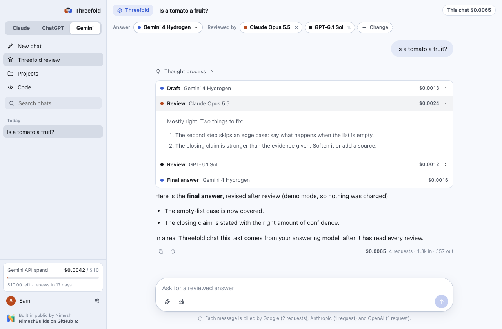
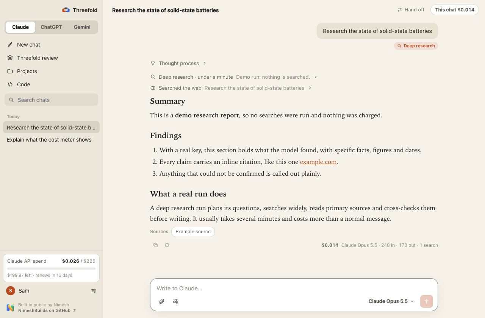
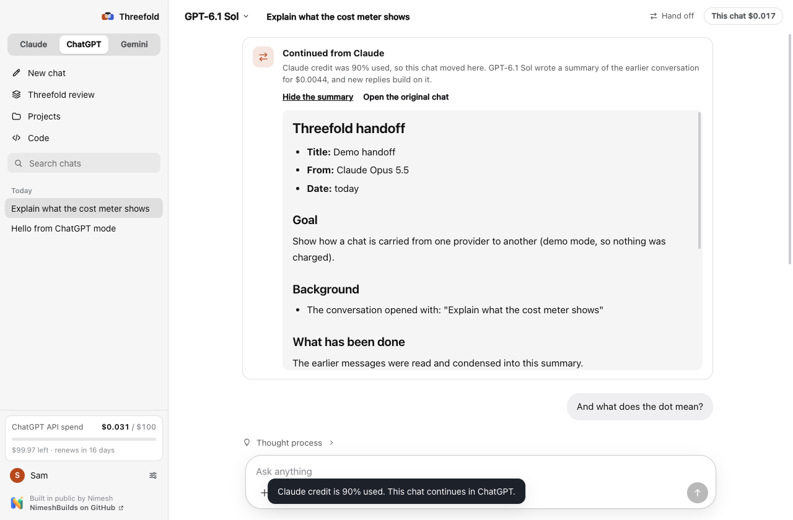
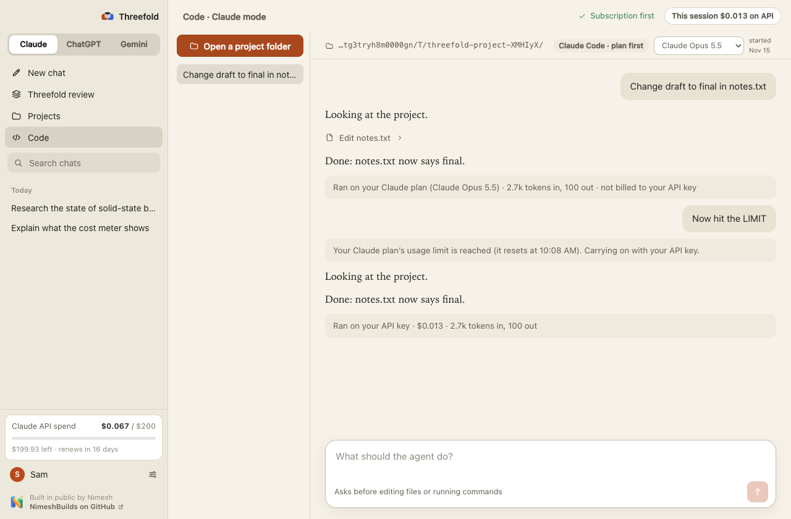

<p align="center"></p>

# Threefold

**Three assistants. One local app. Your own API credits.**

Threefold is a desktop app for macOS with a Claude mode, a ChatGPT mode and a Gemini mode. It talks to the Anthropic, OpenAI and Google APIs directly from your computer with your own API keys, and it shows what every message costs while the reply is still being written.

It exists because paid Claude, ChatGPT and Google AI plans now include monthly API credits that the official apps cannot spend. Threefold gives those credits somewhere to go.

[Website](https://nimeshbuilds.github.io/threefold/) · Built in public by Nimesh under [NimeshBuilds](https://github.com/nimeshbuilds) · [Apache 2.0](LICENSE)

> Threefold is an independent project. It is not made by, affiliated with or endorsed by Anthropic, OpenAI or Google. "Claude", "ChatGPT" and "Gemini" are trademarks of their owners and are used only to say which API a mode connects to.


## What it does

| | Claude mode | ChatGPT mode | Gemini mode |
|---|---|---|---|
| Chat with streaming, model picker, thinking | Yes | Yes | Yes |
| Images, PDFs and text files in a message | Yes | Yes | Yes |
| Web search | Yes, and it reads pages | Yes, and it reads pages | Yes (Google Search), and it reads pages |
| Code execution | Yes, with data files and charts | Yes, with data files and charts | Yes, CSV and TSV files only |
| Deep research | Yes | Yes | Yes (Google's Deep Research agent) |
| Image generation | No: Anthropic's API has no image model | Yes | Yes |
| Live preview panel for pages and SVGs | Yes | Yes | Yes |
| Projects (instructions and reference files) | Yes | Yes | Yes |
| Memory across chats, shared by every mode | Yes | Yes | Yes |
| Coding agent in a project folder | Claude Agent SDK | Threefold's own agent | Threefold's own agent |
| Coding on your subscription first, your API key after | Yes, with Claude Code | Yes, with Codex | No |
| Import history from a data export | Yes | Yes | Activity log, grouped into chats |
| Continue a chat from a handoff summary (the `threefolds` skill) | Yes | Yes | Yes |
| Automatic fallback to another provider when credit runs low | Yes | Yes | Yes |

| ChatGPT mode | Gemini mode |
|---|---|
|  |  |

Screenshots are from demo mode, which is why the replies describe themselves as canned.

### Threefold review

Once two or more providers are connected, the **Threefold review** tab turns on. You pick an answering model and up to four reviewers, from every provider you have a key for: with three keys you can answer with one and have the other two review, or any other mix. Each message then runs in three steps:

1. **Draft.** The answering model replies.
2. **Review.** Every reviewer reads the draft and lists what is wrong or missing. Reviews run at the same time.
3. **Final.** The answering model rewrites its reply with the reviews in hand.



Every step is a separate API request and **every model you pick bills you for its part**: the answering model twice, each reviewer once. The tab says so when it opens, names each provider, and lists the cost of every step under the answer. If a reviewer fails, the others are still used; if none comes back, you get the draft and are told it was not reviewed.

### Deep research

Switch on **Deep research** (the sliders button) for one message. The model plans its questions, searches widely, reads the sources and writes a cited report. It switches itself off after that message. Each provider's API does this differently, so each mode uses its provider's own route:

| Mode | How it runs | What to expect |
|---|---|---|
| Claude | The chat model at `xhigh` effort with web search and web fetch. Anthropic has no separate research endpoint. | Several minutes; many more tokens than a normal reply |
| ChatGPT | Your chosen model at `xhigh` reasoning effort with uncapped web search, in OpenAI's background mode. | Several minutes; OpenAI stores the response, because background mode requires it |
| Gemini | Google's Deep Research agent on the Interactions API. | Usually under 20 minutes; Google estimates $1 to $3 a run, and stores the run |

In **Threefold review**, deep research makes the draft a full research run. The reviewers may then search the web themselves to check the report's claims and sources, and the answering model rewrites it with their findings (with web search available, but not as a second research run).



### Automatic fallback

Each plan's API credit is a monthly allowance, and they rarely run out on the same day. With **automatic fallback** switched on (Settings → Credits), Threefold watches each provider's credit and moves a chat to another provider when the one it is on is nearly used up.

- **It switches at 85% by default.** Once a provider's monthly credit is that far used, your next message goes to another connected provider that has credit to spare. You can change the threshold (70 to 95%) and name a preferred provider; otherwise the one with the most dollars of credit left is used.
- **The chat comes with you.** The provider you move to first writes a **handoff summary** of the conversation so far: the goal, the background, what was done, where things stand and what comes next. A new chat opens in that provider's mode, starts from the summary, and answers the message you were sending. The original chat stays where it was, with a link to where it continues.
- **You are told first.** A note above the message box says that the next message will move, and "Stay on …" keeps that one chat where it is.
- **Nothing is hidden on the bill.** Writing the summary is one extra API request. It is billed by the provider you move to, shown in the new chat with its cost, counted in the meter and recorded in the spend ledger.



What it will not do: it is off until you switch it on; it needs at least two connected providers; it only moves to a provider that has a monthly credit set and is itself under the threshold, so it never shifts your bill onto a card; and Threefold review chats and the Code tab never switch. A new chat with no history simply starts with the provider that has credit, with no summary. If the summary cannot be written, the message is answered by the original provider and you are told why.

A summary carries the gist of a conversation, not every word, and the model you move to has not seen the files or images from the earlier chat. You can hand any chat to another provider yourself with **Hand off** in the top bar.

### Handoff summaries and the `threefolds` skill

The same summary works in the other direction: from the official apps into Threefold, with no export and no import.

`threefolds` is a skill for the official Claude, ChatGPT and Gemini apps. It is one text file of instructions ([skills/threefolds/SKILL.md](skills/threefolds/SKILL.md)) with no code in it. Run it in any existing conversation and the assistant writes a handoff summary of that conversation. Paste the summary into Threefold (**File → Continue from a Handoff…**, or the link under the message box of a new chat) and carry on in whichever mode you like.

Download [threefolds.zip](https://nimeshbuilds.github.io/threefold/skills/threefolds.zip) or the bare [SKILL.md](https://nimeshbuilds.github.io/threefold/skills/threefolds/SKILL.md), then add it to the app:

| App | Where to add it | How to run it | Who has Skills |
|---|---|---|---|
| Claude | Turn on **Code execution and file creation** in Settings → Capabilities. Then **Customize → Skills → + → + Create skill → Upload a skill**, and choose the ZIP. | Type `/threefolds` or ask Claude to "use the threefolds skill" | Every plan, including Free. On Team and Enterprise an owner has to allow them. [Guide](https://support.claude.com/en/articles/12512180) |
| ChatGPT | Sidebar → **Plugins** → **Skills** tab → **Create → Upload from your computer**. ChatGPT scans a skill before it becomes available. | Ask ChatGPT to "use the threefolds skill" | Business, Enterprise, Healthcare and Edu workspaces, where the admin allows uploads. Not personal plans. [Guide](https://help.openai.com/en/articles/20001066) |
| Gemini | On the web or the Mac app: **Customize** (it may be under More) → **Skills** → **Create → Upload**, and select `SKILL.md`. | Type `/` (or `@` with the newer shortcut) and pick threefolds | Personal Google accounts, age 18 or over. [Guide](https://support.google.com/gemini/answer/17094296) |

**No Skills on your plan?** The skill's text also works as a plain prompt. Threefold has a **Copy the prompt** button (in the handoff dialog and in Settings → Import history), and the [website](https://nimeshbuilds.github.io/threefold/#handoff) shows it too. Paste it as a message at the end of the conversation you want to move.

Read a handoff before you paste it anywhere: it is a summary of your conversation, so it can contain whatever you discussed. The skill tells the assistant to leave out passwords, keys and card numbers. A pasted summary costs nothing until you send a message; it then goes to that mode's API as background, billed as input tokens.

### Coding on your subscription first

A Claude or ChatGPT subscription already covers coding in the maker's own command-line tool: Claude Code for Claude, Codex for ChatGPT. In the Code tab, **Use subscription** lets a coding session spend that first and your API credits only afterwards.

- **Your plan is used first.** With the switch on, a new coding session in Claude mode runs through Claude Code, and one in ChatGPT mode through Codex, signed in with your own account.
- **Your API key takes over when the plan runs out.** When the plan's usage limit is reached, Threefold carries on in the same session, with the same tool, on your API key, and says so in the transcript. It remembers when the limit resets and goes back to the plan after that.
- **Every turn says what paid for it.** A turn on your plan ends with "Ran on your Claude plan · not billed to your API key". A turn on the key ends with its cost, which also counts on the meter and in the spend ledger. Work on a plan is never counted as API spend.



**Setting it up, from inside the app.** The panel behind **Use subscription** does three things:

1. **Checks the tool.** It looks for Claude Code or Codex on your Mac, reads its version and looks up the newest one. If the tool is missing or out of date, one button installs or updates it with the maker's own command, which is shown before it runs: the maker's install script for a new install, and `brew upgrade`, `npm install -g …@latest` or the tool's own `update` command for an existing one, depending on how it was installed.
2. **Signs you in.** The button starts the tool's own sign-in, which opens Anthropic's or OpenAI's page in your browser. If the browser shows a code instead of returning to the app, there is a box to paste it into.
3. **Switches it on.** The switch only becomes available once the tool is installed, recent enough and signed in with a subscription.

**What Threefold does and does not do here**

- It runs the tool that is installed on your Mac, exactly as its maker publishes it, in the tool's documented non-interactive mode (`claude -p` and `codex exec`). It does not modify, wrap or replace it.
- It never sees, stores or passes on your password or any sign-in token. The tool keeps its own sign-in, the same one it uses in your terminal.
- A run on your plan gets no API key, not even one that happens to be in your environment. A run on your API key is given the key for that run only (`ANTHROPIC_API_KEY` or `CODEX_API_KEY`); your tool's saved sign-in is not changed.
- With Claude Code, you are still asked before every file edit and every command. Claude Code sends each question to Threefold, which shows the usual "Allow this?" card.
- **Codex is different:** run this way it does not ask before each step. It works in its own sandbox, in which it can change files inside the project folder and nowhere else, and has no network access. The app says so when a session starts.
- On your plan the tool picks its own model. When your API key pays, the session's model is used, so the price is known.

Your plan's own terms and limits apply. Anthropic's rules for products that run Claude Code allow each user to sign in to the unmodified tool with their own subscription, and do not allow an app to offer the Claude sign-in itself or to handle the credentials; this feature is built to that shape. See [Anthropic's page](https://code.claude.com/docs/en/legal-and-compliance) and [OpenAI's Codex documentation](https://developers.openai.com/codex/noninteractive). Gemini mode has no subscription route.

### What each API offers, and what Threefold uses

Checked against each provider's documentation and SDK in November 2026.

| Capability | Anthropic | OpenAI | Google | In Threefold |
|---|---|---|---|---|
| Web search | Yes | Yes | Yes | All three modes |
| Open and read a web page | Web fetch | Part of web search | URL context | All three modes, with web search |
| Code execution sandbox | Yes | Code interpreter | Yes | All three modes |
| Deep research | No endpoint; done with the chat model | No dedicated model any more; done with a reasoning model in background mode | Deep Research agent | All three modes, and Threefold review |
| Image generation | No | Yes | Yes (Nano Banana) | ChatGPT and Gemini modes |
| Memory | Memory tool | No built-in | No built-in | Threefold's own, shared by every mode |
| Remote MCP connectors | Yes | Yes | Yes | Not yet |
| File search over uploaded documents | No | Yes | Yes | Not yet (projects send files directly) |
| Office file creation (slides, sheets) | Agent Skills | Through code interpreter | Through code execution | Not yet |
| Computer or browser use | Yes | Yes | Yes | No |
| Voice, live audio | No | Realtime | Live | No |
| Video and music generation | No | Yes | Yes | No |

### Cost, live

- Every reply shows its cost under it, with the model and token counts.
- The top bar shows the running total for the open chat. It ticks up while the reply streams (marked "≈") and settles to the exact figure when the API reports the final token counts.
- The sidebar shows this billing cycle's spend against your monthly credit grant, and how many days until it renews.
- Settings → Spend breaks it down by model and by day, per provider.


## Quick start

There are two ways to get Threefold onto your Mac. Download the ready-made app, or build it from this source.

### Option A: download the app

For Apple Silicon Macs (M1 or later) on macOS 13 or later. On an Intel Mac, use Option B.

> **The app is not signed by Apple.** Threefold is not signed with an Apple Developer ID and has not been notarized, so Apple has not checked this build. macOS blocks apps like that by default, and you have to allow it yourself, once, in System Settings (steps 3 to 5). Apple advises against doing this for software you do not trust. If you would rather not, use Option B: an app built on your own Mac opens without the warning.

1. Download [Threefold-mac-arm64.zip](https://github.com/nimeshbuilds/threefold/releases/latest/download/Threefold-mac-arm64.zip) (about 290 MB). The checksum is on the [releases page](https://github.com/nimeshbuilds/threefold/releases).
2. Double-click the ZIP in your Downloads folder, then drag **Threefold** into **Applications**.
3. Double-click Threefold. macOS stops it and says Apple could not verify the app. Click **Done**. Do not choose Move to Trash.
4. Open **System Settings → Privacy & Security** and scroll down to **Security**. Next to the note that Threefold was blocked, click **Open Anyway**. The button is only there for about an hour after step 3.
5. Confirm with **Open Anyway** and enter your Mac login password. Threefold opens, and from now on a normal double-click is enough.

These are Apple's own steps for [opening an app from an unknown developer](https://support.apple.com/guide/mac-help/open-a-mac-app-from-an-unknown-developer-mh40616/mac).

If you prefer Terminal, or macOS says the app "is damaged", remove the "downloaded from the internet" flag after step 2 and then open Threefold normally:

```bash
xattr -dr com.apple.quarantine /Applications/Threefold.app
```

After you replace the app with a newer version, macOS may ask once for your login password so Threefold can read its saved API keys from the Keychain. Choose Always Allow.

### Option B: build it from source

You need macOS 13 or later, Git, Node.js 22 or later and pnpm 10.

1. Install the tools you are missing. Git comes with Apple's command line tools, and Node.js is at [nodejs.org](https://nodejs.org/).

   ```bash
   xcode-select --install
   ```

   ```bash
   npm install -g pnpm@10
   ```

2. Get the source and go into its folder.

   ```bash
   git clone https://github.com/nimeshbuilds/threefold
   ```

   ```bash
   cd threefold
   ```

3. Install what it depends on. This downloads Electron, so give it a few minutes.

   ```bash
   pnpm install
   ```

4. Run it. This starts Threefold straight from the source, with no macOS warning.

   ```bash
   pnpm dev
   ```

5. Optional: build an app you can keep in Applications. See [Build a Mac app](#build-a-mac-app).

## Setup

The first launch opens a short wizard. For each mode you want:

1. **Claim your monthly API credits**, if your plan has them.
   - Claude: Max ($100), Ultra ($200) and Team plans. In Claude go to Settings → Billing → API credits and link an API organization. [Anthropic's guide](https://support.claude.com/en/articles/17154008-monthly-api-credits-for-max-ultra-and-team-plans)
   - ChatGPT: Pro ($100, $200 or $500) and Business plans. In ChatGPT go to Settings → Billing → API credits. [OpenAI's guide](https://help.openai.com/en/articles/20001626-api-credits-benefit-for-eligible-chatgpt-subscriptions)
   - Gemini: Google AI Pro ($10), Ultra 5x ($40) and Ultra 20x ($100). Claim them in Google AI Studio; Google asks for a one-time $5 prepayment before they can be used. [Google's guide](https://aistudio.google.com/learn/claim-google-ai-plan-credits-in-ai-studio)
2. **Create an API key** in that same organization or project: [Claude Console](https://platform.claude.com/settings/keys), [OpenAI API Platform](https://platform.openai.com/api-keys) or [Google AI Studio](https://aistudio.google.com/apikey).
3. **Paste the key into Threefold.** It is checked with a free request and stored encrypted.

Without plan credits everything still works; usage is billed to the payment method on your API account. Gemini also has a free tier with low limits.

To try the interface without any key (from source):

```bash
pnpm demo
```

Demo mode makes no network calls and costs nothing. Replies are canned.

## Importing your history

To carry on with just one conversation, a [handoff summary](#handoff-summaries-and-the-threefolds-skill) is quicker than an export. To bring every old chat in word for word, ask each company for an export of your data, then hand the ZIP to Threefold. Do not unzip it.

**Claude**

1. On [claude.ai](https://claude.ai/settings) or in the Claude desktop app (not the phone app), open **Settings → Privacy** and click **Export data**.
2. Claude emails a download link to your account's address. Open it while signed in; it expires after 24 hours.

On a Team or Enterprise plan, export works only if an owner has allowed members to export their data. [Anthropic's guide](https://support.claude.com/en/articles/9450526)

**ChatGPT**

1. In [ChatGPT](https://chatgpt.com/), open your profile menu, then **Settings → Data controls**. Next to **Export data** click **Export**, then **Confirm export**.
2. ChatGPT emails or texts you when the export is ready. That is often quick but can take days. Download it while signed in to the same account; the link expires after 24 hours.

Business and Enterprise workspaces do not offer this export. [OpenAI's guide](https://help.openai.com/en/articles/7260999)

**Gemini**

Google has no conversation export. What it does export is your Gemini activity log, through Google Takeout.

1. Open [Google Takeout](https://takeout.google.com/) and click **Deselect all**. Scroll to **My Activity** and tick it. Not the separate *Gemini* entry: that one holds your Gems, not your chats.
2. Under My Activity click **All activity data included**, choose **Deselect all**, tick only **Gemini Apps** and confirm.
3. Still under My Activity click **Multiple formats** and set **Activity records** to **JSON**. The default is HTML, which Threefold cannot read.
4. Click **Next step**, then **Create export**. Google emails you a download link.

Because this is an activity log and not a list of conversations, Threefold groups prompts made within half an hour of each other into one chat. Only activity Gemini was saving (Gemini Apps Activity switched on) is included, and work or school accounts may not allow the export.

**Then, in Threefold**

Open **Settings → Import history**. Under that provider's heading click **Choose export file…** and select the ZIP. The first-launch wizard offers the same step. The chats appear in that mode's sidebar and can be continued through the API.

An export is a snapshot: pictures and uploaded files are not in it, and chats continued in Threefold do not sync back. Importing the same export again adds only what is new. Reading old chats is free; continuing one sends its history to the API and is billed like any other message.

## Build a Mac app

```bash
pnpm dist
```

This produces `dist/mac-arm64/Threefold.app`. Drag it into Applications. A build made on your own Mac opens with a normal double-click, because macOS only checks apps that were downloaded.

To make the ZIP that is attached to a release:

```bash
pnpm release:zip
```

That builds the app, signs it ad hoc (a local signature with no Apple identity, which keeps macOS from reporting a downloaded copy as damaged), checks the signature and writes `dist/Threefold-mac-arm64.zip` with its SHA-256. The result is still not notarized, so anyone who downloads it has to follow the steps in [Option A](#option-a-download-the-app).

## How cost is calculated

Threefold multiplies the token counts each API response reports by the prices in [`src/shared/pricing.ts`](src/shared/pricing.ts), which were copied from the providers' public pricing pages on the date recorded in that file.

Things to know:

- **Threefold cannot read your real credit balance.** The meter counts what Threefold itself spent. Usage from other tools on the same API account is not included.
- **Prices change.** Price changes a provider has already announced are in the table and take effect on their start date (for example Gemini 4 Carbon and Argon double on 1 December 2026). Anything else needs an edit to `pricing.ts`. A model that is not in the table shows "cost unknown" and is not counted.
- **Estimates are marked.** While a reply streams, output tokens are estimated from text length. A reply you stop early keeps its estimate.
- **Web search:** $0.01 per search on Anthropic and OpenAI. Google includes 5,000 searches a month and then charges $0.014 each; Threefold counts its own searches against that allowance.
- **Deep research on Gemini is an estimate.** Google bills its research agent at "standard Gemini list rates" without naming the model. Threefold prices the reported tokens at the Gemini 4 Carbon rate, which matches Google's own cost examples, and marks the figure with "≈". No cost is shown while a Gemini research run is in progress, because Google reports usage only at the end.
- **Images:** Gemini images are counted (about $0.03 each at the default size). OpenAI image generation is not counted, because the API does not report its cost with the reply.
- **Also not counted:** Anthropic code-execution container time beyond its free allowance, and OpenAI long-context pricing above 272K prompt tokens (flagged with a "+" when it applies). OpenAI's code sandbox is counted at $0.03 per 20-minute session, which is an approximation.
- **Long chats cost more per message.** Each request resends the conversation. Caching cuts the cost of the repeated part, but it still grows.
- **Google's credits roll over** for 12 months, unlike the other two. The meter still counts one month at a time.

## Privacy and security

- No Threefold server, account or telemetry. Requests go from your computer to the Anthropic, OpenAI and Google APIs and nowhere else.
- API keys are encrypted with Electron `safeStorage`, which keeps its encryption key in the macOS Keychain.
- Chats, projects, memory and the spend ledger are plain JSON files in `~/Library/Application Support/Threefold/data`.
- Ordinary OpenAI requests are sent with `store: false`. **Deep research is the exception:** OpenAI's background mode and Google's research agent both require the run to be stored on their side.
- Each provider's normal API data policies apply; note that Google may use free-tier (unbilled) Gemini API content to improve its products.
- In a Threefold review, your message and the draft answer are sent to every reviewer's provider.
- When a chat moves to another provider, by automatic fallback or because you handed it off, the conversation so far is sent to that provider so it can write the handoff summary. Fallback is off until you switch it on.
- The window runs sandboxed with context isolation. Pages the model writes are previewed in a sandboxed frame with no access to the app.
- The coding agents can read the project folder you choose. They ask before every file edit and every shell command, and Threefold's own agents cannot touch paths outside that folder. The one exception is Codex on your ChatGPT subscription, which does not ask: it works in its own sandbox, limited to the project folder and without network access.
- With "Use subscription" on, coding runs through the Claude Code or Codex CLI installed on your Mac. Threefold never reads their sign-in. Installing or updating a CLI from the app runs its maker's own command, shown first, and looking up the newest version asks the npm registry for the package's version number and nothing else.

## Development

```bash
pnpm typecheck
```

```bash
pnpm test:run
```

```bash
pnpm test:e2e
```

| Path | What is there |
|---|---|
| `src/main/providers/` | The three chat providers, the live cost meter and a demo provider |
| `src/main/panel.ts` | The Threefold review engine (draft, review, final) |
| `src/main/code/` | The three coding agents and their shared file and shell tools |
| `src/main/code/cli.ts` | Finding, checking, installing, updating and signing in to Claude Code and Codex |
| `src/main/code/claudeCli.ts`, `codexCli.ts` | Running a coding session through those CLIs, on the plan or the API key |
| `src/main/code/permissionBridge.ts` | How Claude Code asks you before each edit or command when Threefold runs it |
| `src/main/importers.ts` | Parsers for the ChatGPT, Claude and Gemini exports |
| `src/main/handoff.ts`, `src/shared/handoff.ts` | Writing, reading and passing on handoff summaries |
| `src/shared/fallback.ts` | Deciding when a chat moves to another provider |
| `skills/threefolds/` | The `threefolds` skill; `pnpm skill` publishes it to `docs/skills/` |
| `src/main/store.ts` | Local JSON storage and the spend ledger |
| `src/shared/pricing.ts` | Price table and cost maths |
| `src/renderer/` | The React interface |
| `tests/live/` | Checks against the real APIs (run by hand, see below) |
| `docs/` | The website, served by GitHub Pages |
| `brand/` | Logo, icon and the brand guide |

## What has and has not been tested

**Tested automatically, with no API key:**

- 181 unit tests: price maths including announced price changes and image pricing, the three export parsers, importing real ZIP archives laid out like each provider's export, automatic fallback (when it switches, where to, what is billed, what happens when the summary fails or is stopped), handoff summaries and the published skill files, coding on a subscription (finding, updating and signing in to the CLIs, plan-first runs, permission prompts, falling back to the API key in the same session, what is billed), storage and the spend ledger, file-tool path confinement, the cost meter, the research helpers, and the Threefold review engine (ordering, prompts, failed or missing reviewers, stop, cost adding up, deep research).
- 123 end-to-end checks that drive the real app in demo mode, on both the development build and the packaged `Threefold.app`: the wizard, all three modes, live cost, the preview panel, image generation, deep research, the Threefold review tab and its billing notice, coding on a subscription (updating the CLI, signing in, a run on the plan, the limit and the switch to the API key), automatic fallback, manual handoff, pasting a handoff, projects, memory, spend, dark theme and what is written to disk.

**Not run against the real APIs by the automated tests.** The provider code is written against the official SDK type definitions and documentation and compiles against them. A live suite is ready for checking it with your own keys:

```bash
ANTHROPIC_API_KEY=... OPENAI_API_KEY=... GEMINI_API_KEY=... pnpm test:live
```

Set any subset of the three keys. For each provider it checks the key, streaming and exact cost, the default model, multi-turn context, image and file input, the memory tool, web search, code execution, image generation, stopping mid-reply and chat naming, then runs one Threefold review across the providers you supplied. It uses the cheapest models where it can and prints what it spent, which should be well under a dollar.

Deep research is left out of that run because it takes minutes and costs real money. Add `THREEFOLD_LIVE_RESEARCH=1` to include one research run per provider (expect a few dollars with all three keys).

Also not verified: the Gemini importer against a real Takeout file (it is tested against Google's documented record shape and folder layout), the first-launch macOS warning on a freshly downloaded copy of the release, and the three coding agents against real projects.

Not verified for coding on a subscription: a real run on a real plan. The tests use stand-ins that play Claude Code and Codex, written from the tools' documented output. Against the real tools on a real Mac, only this much was checked: that Threefold finds them, reads their version, install method and sign-in state correctly, and that both accept the exact options Threefold passes. What a real usage-limit message looks like, and installing or signing in for real, were not exercised.

Not verified for fallback and handoff: a summary written by a real model (the tests use stand-in providers, so the quality of real summaries is untested), and uploading the `threefolds` skill inside the official Claude, ChatGPT and Gemini apps. The install steps follow each company's help pages as they read in November 2026; the skill has not been run inside those apps.

## Licence

Threefold is licensed under the [Apache License 2.0](LICENSE). See [NOTICE](NOTICE).

The downloadable app bundles third-party software that keeps its own licence, including Electron and Anthropic's Claude Agent SDK runtime; those parts are not covered by Threefold's licence.
