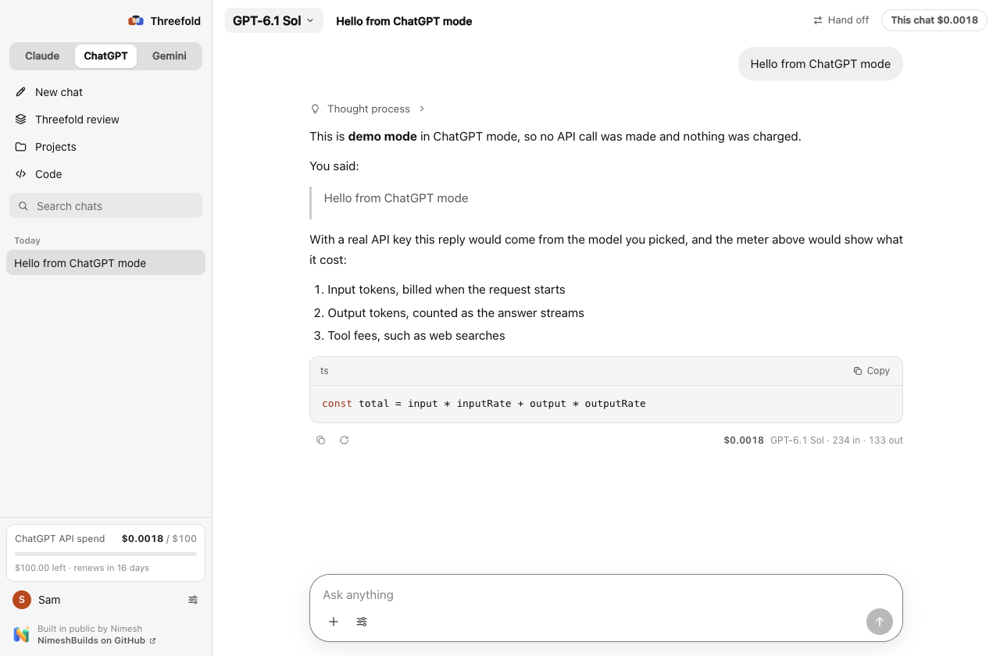
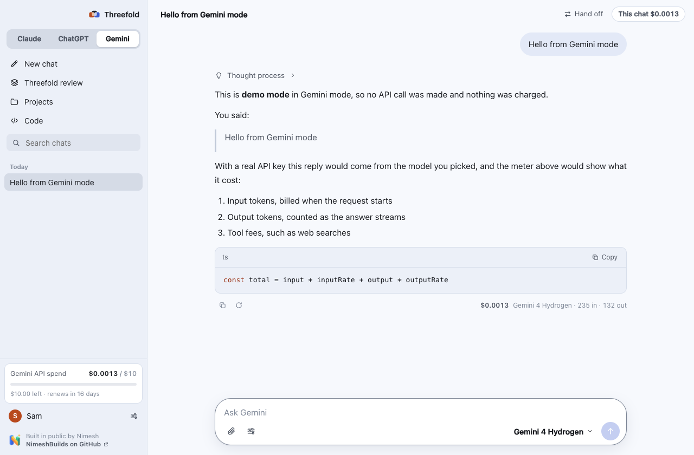
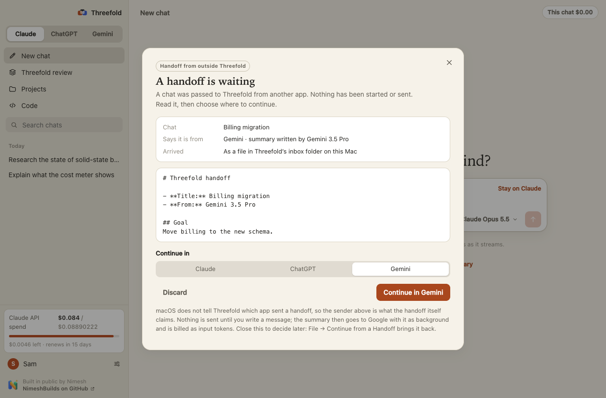
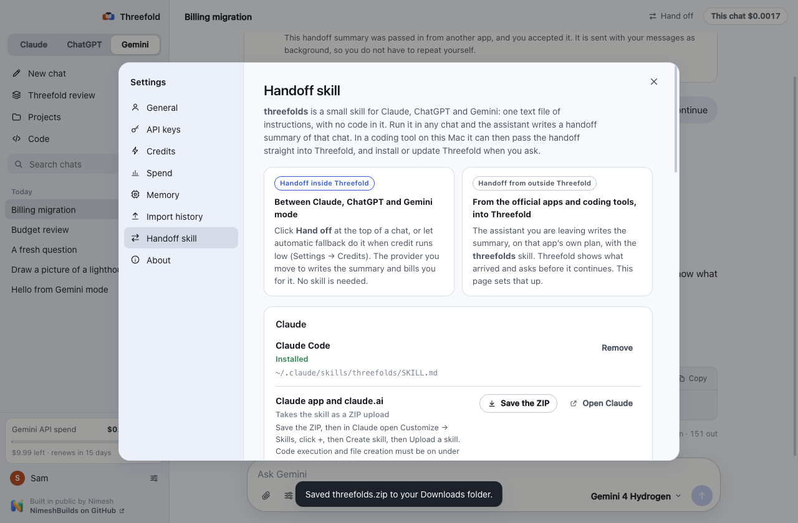
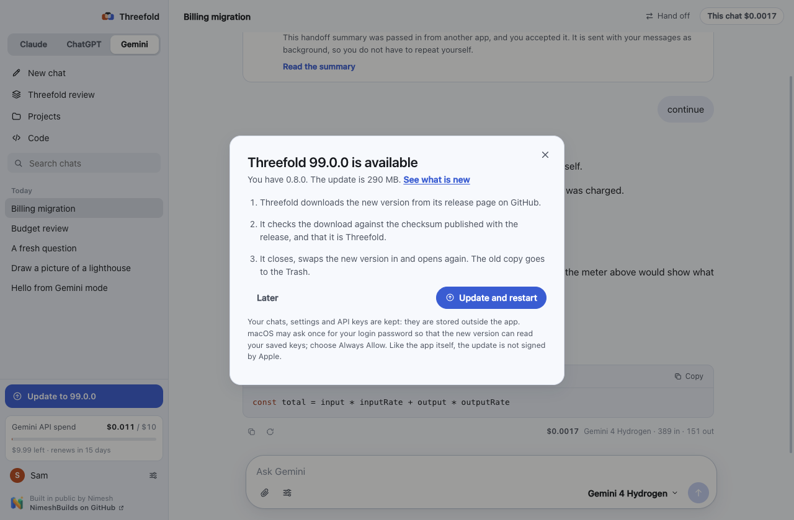

<p align="center"></p>

# Threefold

**Three assistants. One local app. Your own API credits.**

Threefold is a desktop app for macOS with a Claude mode, a ChatGPT mode and a Gemini mode. It talks to the Anthropic, OpenAI and Google APIs directly from your computer with your own API keys, and it shows what every message costs while the reply is still being written.

It exists because paid Claude, ChatGPT and Google AI plans now include monthly API credits that the official apps cannot spend. Threefold gives those credits somewhere to go.

[Website](https://nimeshbuilds.github.io/threefold/) · Built in public by Nimesh under [NimeshBuilds](https://github.com/nimeshbuilds) · [Apache 2.0](LICENSE)

> Threefold is an independent project. It is not made by, affiliated with or endorsed by Anthropic, OpenAI or Google. "Claude", "ChatGPT" and "Gemini" are trademarks of their owners and are used only to say which API a mode connects to.


## What it does

| | Claude mode | ChatGPT mode | Gemini mode |
|---|---|---|---|
| Chat with streaming, model picker, thinking | Yes | Yes | Yes |
| Images, PDFs and text files in a message | Yes | Yes | Yes |
| Web search | Yes, and it reads pages | Yes, and it reads pages | Yes (Google Search), and it reads pages |
| Code execution | Yes, with data files and charts | Yes, with data files and charts | Yes, CSV and TSV files only |
| Deep research | Yes | Yes | Yes (Google's Deep Research agent) |
| Image generation | No: Anthropic's API has no image model | Yes | Yes |
| Live preview panel for pages and SVGs | Yes | Yes | Yes |
| Projects (instructions and reference files) | Yes | Yes | Yes |
| Memory across chats, shared by every mode | Yes | Yes | Yes |
| Coding agent in a project folder | Claude Agent SDK | Threefold's own agent | Threefold's own agent |
| Coding on your subscription first, your API key after | Yes, with Claude Code | Yes, with Codex | No |
| Import history from a data export | Yes | Yes | Activity log, grouped into chats |
| Continue a chat from a handoff summary (the `threefolds` skill) | Yes | Yes | Yes |
| Automatic fallback to another provider when credit runs low | Yes | Yes | Yes |

| ChatGPT mode | Gemini mode |
|---|---|
|  |  |

Screenshots are from demo mode, which is why the replies describe themselves as canned.

Two more things belong to the app as a whole: it [updates itself with one click](#updates) when a new release is out, and the [`threefolds` skill](#handoff-summaries-and-the-threefolds-skill) lets Claude, ChatGPT and Gemini hand a conversation over to it.

### Threefold review

Once two or more providers are connected, the **Threefold review** tab turns on. You pick an answering model and up to four reviewers, from every provider you have a key for: with three keys you can answer with one and have the other two review, or any other mix. Each message then runs in three steps:

1. **Draft.** The answering model replies.
2. **Review.** Every reviewer reads the draft and lists what is wrong or missing. Reviews run at the same time.
3. **Final.** The answering model rewrites its reply with the reviews in hand.


Every step is a separate API request and **every model you pick bills you for its part**: the answering model twice, each reviewer once. The tab says so when it opens, names each provider, and lists the cost of every step under the answer. If a reviewer fails, the others are still used; if none comes back, you get the draft and are told it was not reviewed.

### Deep research

Switch on **Deep research** (the sliders button) for one message. The model plans its questions, searches widely, reads the sources and writes a cited report. It switches itself off after that message. Each provider's API does this differently, so each mode uses its provider's own route:

| Mode | How it runs | What to expect |
|---|---|---|
| Claude | The chat model at `xhigh` effort with web search and web fetch. Anthropic has no separate research endpoint. | Several minutes; many more tokens than a normal reply |
| ChatGPT | Your chosen model at `xhigh` reasoning effort with uncapped web search, in OpenAI's background mode. | Several minutes; OpenAI stores the response, because background mode requires it |
| Gemini | Google's Deep Research agent on the Interactions API. | Usually under 20 minutes; Google estimates $1 to $3 a run, and stores the run |

In **Threefold review**, deep research makes the draft a full research run. The reviewers may then search the web themselves to check the report's claims and sources, and the answering model rewrites it with their findings (with web search available, but not as a second research run).


### Two kinds of handoff

A handoff is a summary that lets a conversation carry on somewhere else, so you do not start again. Threefold has two kinds, and the app labels each one:

| | Handoff inside Threefold | Handoff from outside Threefold |
|---|---|---|
| What moves | A chat goes from one mode to another: Claude, ChatGPT, Gemini | A chat comes in from the official Claude, ChatGPT or Gemini app, or from Claude Code, Codex or Gemini CLI |
| How it starts | **Hand off** at the top of a chat, or by itself when a provider's credit runs low ([automatic fallback](#automatic-fallback)) | You run the [`threefolds` skill](#handoff-summaries-and-the-threefolds-skill) in the app you are leaving |
| Who writes the summary | The provider you move to, through its API. Threefold sends it the conversation so far | The assistant you are leaving, on that app's own plan. Threefold only ever sees the summary |
| What it costs in Threefold | One extra request, billed by that provider and shown in the chat | Nothing until you send a message; the summary then goes along as background |
| What you set up | Two connected providers. No skill | The skill, once per app |

### Automatic fallback

Each plan's API credit is a monthly allowance, and they rarely run out on the same day. With **automatic fallback** switched on (Settings → Credits), Threefold watches each provider's credit and moves a chat to another provider when the one it is on is nearly used up.

- **It switches at 85% by default.** Once a provider's monthly credit is that far used, your next message goes to another connected provider that has credit to spare. You can change the threshold (70 to 95%) and name a preferred provider; otherwise the one with the most dollars of credit left is used.
- **The chat comes with you.** The provider you move to first writes a **handoff summary** of the conversation so far: the goal, the background, what was done, where things stand and what comes next. A new chat opens in that provider's mode, starts from the summary, and answers the message you were sending. The original chat stays where it was, with a link to where it continues.
- **You are told first.** A note above the message box says that the next message will move, and "Stay on …" keeps that one chat where it is.
- **Nothing is hidden on the bill.** Writing the summary is one extra API request. It is billed by the provider you move to, shown in the new chat with its cost, counted in the meter and recorded in the spend ledger.


What it will not do: it is off until you switch it on; it needs at least two connected providers; it only moves to a provider that has a monthly credit set and is itself under the threshold, so it never shifts your bill onto a card; and Threefold review chats and the Code tab never switch. A new chat with no history simply starts with the provider that has credit, with no summary. If the summary cannot be written, the message is answered by the original provider and you are told why.

A summary carries the gist of a conversation, not every word, and the model you move to has not seen the files or images from the earlier chat. You can hand any chat to another provider yourself with **Hand off** in the top bar.

### Handoff summaries and the `threefolds` skill

The same summary works in the other direction: from the official apps into Threefold, with no export and no import.

`threefolds` is a skill for Claude, ChatGPT and Gemini: their chat apps and their coding tools (Claude Code, Codex, Gemini CLI). It is one text file of instructions ([skills/threefolds/SKILL.md](skills/threefolds/SKILL.md)) with no code in it. It does three things:

- **Writes a handoff.** Run it in any existing conversation and the assistant writes a handoff summary of that conversation.
- **Passes it to Threefold.** In a coding tool on your Mac, the assistant sees that Threefold is installed and asks whether to pass the handoff in. If you say yes, it saves the handoff as a file in Threefold's inbox folder and opens the app. If the tool is not allowed to open another app (Codex's sandbox is not), Threefold notices the saved file by itself while it is open, and otherwise shows it the next time you open it. In a chat app, copy the reply and choose **File → Continue from a Handoff…** in Threefold, which takes the handoff from your clipboard; the link at the end of the reply does the same from the browser.
- **Installs Threefold when you ask.** See [Option C](#option-c-let-your-coding-assistant-install-it).



#### What the skill does, in order

1. **It looks for Threefold first,** before it writes anything, with one command that prints the system's name and either `threefold-is-installed` or `threefold-is-not-installed`. A chat app cannot run that command on your Mac, so there the answer is "unknown".
2. **It writes the handoff:** goal, background, what was done, where things stand, what is next, the details that must not be lost, and how you like to work. Passwords, keys and card numbers are left out.
3. **It passes the handoff on,** according to what step 1 found:
   - **Installed.** It asks whether to pass the handoff in. On your yes it saves the handoff in Threefold's inbox folder and opens Threefold.
   - **Not installed.** It tells you how to carry the handoff over, and offers to install Threefold.
   - **Unknown.** It tells you how to carry the handoff over: copy the reply, then **File → Continue from a Handoff…** in Threefold, or the link, or paste it into any other app. It says nothing about whether Threefold is installed.

The skill may not say that Threefold is installed, or that it is not, unless it ran the check in that turn and saw the answer. And it never puts any part of a conversation into a link.

#### Threefold asks before it does anything

A handoff that reaches the app from outside is shown to you in full first: its title, who it says it is from, and how it arrived. Threefold picks the mode that matches the sender (Claude mode for a chat from Claude) and you can pick another, or discard it. No chat exists until you continue, and nothing goes to a provider until you send a message.

- **The link carries nothing.** `threefold://handoff` only tells the app to look for a handoff that is already on your Mac. Anything else put into the link is ignored, and no other `threefold://` link does anything.
- **Two places are looked at, no others:** Threefold's inbox folder (`~/Library/Application Support/Threefold/inbox`), which the app watches while it is open; and your clipboard, only when a link or you (File → Continue from a Handoff…) ask. Text that is not a Threefold handoff is left alone.
- **Files are checked.** A file is taken only if it is a plain file that you own, named `handoff-….md`, under 1 MB and less than a day old. Links to other files are never followed.
- **The sender is a claim.** macOS does not tell an app who opened a link, so Threefold shows what the handoff says about itself (in the link, or in the file's name, which the skill ends with `-claude`, `-chatgpt` or `-gemini`), and points out when that and the summary disagree.
- **The skill never puts a conversation into a link.** Its instructions say so, and the page a chat app links to ([/open/](https://nimeshbuilds.github.io/threefold/open/)) receives nothing from your chat.

**File → Continue from a Handoff…** (or the link under the message box of a new chat) is the route that always works: it shows a handoff that is waiting in the inbox, takes one you have copied from the clipboard, and otherwise gives you a box to paste into. Threefold recognises a handoff even when a chat app's Copy button has stripped its formatting.

#### Install the skill

**From inside Threefold (easiest).** Open **Settings → Handoff skill** and click **Install** next to Claude Code, Codex or Gemini CLI. Threefold writes the one skill file into that tool's skills folder, shows you where, and can remove it again. The same tab saves the ZIP for the Claude app, copies the message that creates the skill in ChatGPT and Gemini, and lists commands to try.

When an update to Threefold changes the skill, the tab says that an older copy is installed and offers **Update**. A copy that is newer than the app's own, for example one installed from GitHub, is left as it is.



**Straight from GitHub**, with no file to download or unzip:

| Tool | Install | Run |
|---|---|---|
| Claude Code | `mkdir -p ~/.claude/skills/threefolds && curl -fsSL https://raw.githubusercontent.com/nimeshbuilds/threefold/main/skills/threefolds/SKILL.md -o ~/.claude/skills/threefolds/SKILL.md` | `/threefolds` |
| Codex | Ask Codex: `$skill-installer install the skill at https://github.com/nimeshbuilds/threefold/tree/main/skills/threefolds`. Or: `mkdir -p ~/.agents/skills/threefolds && curl -fsSL https://raw.githubusercontent.com/nimeshbuilds/threefold/main/skills/threefolds/SKILL.md -o ~/.agents/skills/threefolds/SKILL.md`, then restart Codex. | `$threefolds` |
| Gemini CLI | `gemini skills install https://github.com/nimeshbuilds/threefold.git --path skills/threefolds` | Ask it to "use the threefolds skill" |

**In the chat apps**, skills live in your account, so they are added there. However the skill was added, the last step is the same: copy the assistant's reply, then choose **File → Continue from a Handoff…** in Threefold.

| App | Where to add it | How to run it | Who has Skills |
|---|---|---|---|
| Claude | Only by uploading a ZIP; there is no way to add a skill from a link. Get [threefolds.zip](https://nimeshbuilds.github.io/threefold/skills/threefolds.zip) (or **Save the ZIP** in Threefold), turn on **Code execution and file creation** in Settings → Capabilities, then **Customize → Skills → + → + Create skill → Upload a skill**. | Type `/threefolds` or ask Claude to "use the threefolds skill" | Every plan, including Free. On Team and Enterprise an owner has to allow them. [Guide](https://support.claude.com/en/articles/12512180) |
| ChatGPT | Paste the install message (the **Copy the install message** button in Threefold or on the website) into a chat, or upload the ZIP under Sidebar → **Plugins** → **Skills** → **Create**. ChatGPT scans a skill before it becomes available. | Ask ChatGPT to "use the threefolds skill" | Business, Enterprise, Healthcare and Edu workspaces, where the admin allows it. Not personal plans. [Guide](https://help.openai.com/en/articles/20001066) |
| Gemini | Paste the install message into a new chat, review what Gemini shows and click **Create**. Or upload [SKILL.md](https://nimeshbuilds.github.io/threefold/skills/threefolds/SKILL.md) under **Customize → Skills → Create → Upload**. | Type `/` (or `@` with the newer shortcut) and pick threefolds | Personal Google accounts, age 18 or over. [Guide](https://support.google.com/gemini/answer/17094296) |

**No Skills on your plan?** The skill's text also works as a plain prompt. Threefold has a **Copy the prompt** button (in the handoff dialog, in Settings → Import history and in Settings → Handoff skill), and the [website](https://nimeshbuilds.github.io/threefold/#handoff) shows it too. Paste it as a message at the end of the conversation you want to move.

#### Things to try

| Type this | Where | What happens |
|---|---|---|
| `/threefolds` | Claude Code, the Claude app, the Gemini app | A handoff summary of the whole chat |
| `/threefolds and open it in Threefold` | Claude Code | The handoff is written and passed straight in. You are asked before anything opens. |
| `$threefolds then pass it to Threefold` | Codex | The same in Codex, where skills start with a dollar sign |
| `Use the threefolds skill. Keep the latest draft in full.` | Any assistant | Plain words work everywhere, and you can say what must not be shortened |
| `/threefolds install Threefold` | Claude Code, Codex, Gemini CLI | Installs or updates the app, after asking |

Read a handoff before you continue with it: it is a summary of your conversation, so it can contain whatever you discussed. The skill tells the assistant to leave out passwords, keys and card numbers. A handoff costs nothing until you send a message; it then goes to that mode's API as background, billed as input tokens.

## Quick start

There are three ways to get Threefold onto your Mac. Download the ready-made app, build it from this source, or let a coding assistant you already use install it.

### Option A: download the app

For Apple Silicon Macs (M1 or later) on macOS 13 or later. On an Intel Mac, use Option B.

> **The app is not signed by Apple.** Threefold is not signed with an Apple Developer ID and has not been notarized, so Apple has not checked this build. macOS blocks apps like that by default, and you have to allow it yourself, once, in System Settings (steps 3 to 5). Apple advises against doing this for software you do not trust. If you would rather not, use Option B: an app built on your own Mac opens without the warning.

1. Download [Threefold-mac-arm64.zip](https://github.com/nimeshbuilds/threefold/releases/latest/download/Threefold-mac-arm64.zip) (about 290 MB). The checksum is on the [releases page](https://github.com/nimeshbuilds/threefold/releases).
2. Double-click the ZIP in your Downloads folder, then drag **Threefold** into **Applications**.
3. Double-click Threefold. macOS stops it and says Apple could not verify the app. Click **Done**. Do not choose Move to Trash.
4. Open **System Settings → Privacy & Security** and scroll down to **Security**. Next to the note that Threefold was blocked, click **Open Anyway**. The button is only there for about an hour after step 3.
5. Confirm with **Open Anyway** and enter your Mac login password. Threefold opens, and from now on a normal double-click is enough.

These are Apple's own steps for [opening an app from an unknown developer](https://support.apple.com/guide/mac-help/open-a-mac-app-from-an-unknown-developer-mh40616/mac).

If you prefer Terminal, or macOS says the app "is damaged", remove the "downloaded from the internet" flag after step 2 and then open Threefold normally:

```bash
xattr -dr com.apple.quarantine /Applications/Threefold.app
```

After you replace the app with a newer version, macOS may ask once for your login password so Threefold can read its saved API keys from the Keychain. Choose Always Allow. From 0.8.0 on you do not replace it by hand: see [Updates](#updates).

### Option B: build it from source

You need macOS 13 or later, Git, Node.js 22 or later and pnpm 10.

1. Install the tools you are missing. Git comes with Apple's command line tools, and Node.js is at [nodejs.org](https://nodejs.org/).

   ```bash
   xcode-select --install
   ```

   ```bash
   npm install -g pnpm@10
   ```

2. Get the source and go into its folder.

   ```bash
   git clone https://github.com/nimeshbuilds/threefold
   ```

   ```bash
   cd threefold
   ```

3. Install what it depends on. This downloads Electron, so give it a few minutes.

   ```bash
   pnpm install
   ```

4. Run it. This starts Threefold straight from the source, with no macOS warning.

   ```bash
   pnpm dev
   ```

5. Optional: build an app you can keep in Applications. See [Build a Mac app](#build-a-mac-app).

### Option C: let your coding assistant install it

If you use Claude Code, Codex or Gemini CLI, [add the `threefolds` skill](#install-the-skill) and ask for it in a session:

```
/threefolds install Threefold
```

The assistant checks that your Mac can run the app (Apple Silicon, macOS 13 or later), tells you that the app is not signed by Apple, and waits for your yes. Then it downloads the app and its checksum from this repository's latest release, checks one against the other, checks that the app's seal is intact and that it is Threefold, puts it in Applications and opens it. Asking again later brings a newer version in; the old copy goes to the Trash, and your chats and keys are kept.

The skill forbids the assistant to use `sudo`, to ask for your password, to change any macOS security setting, to remove the quarantine flag from a file, or to touch your API keys.

> **What you should know.** An app fetched this way is not marked as "downloaded from the internet", so macOS does not show the warning from Option A. You are relying on this project instead of on Apple's check. Say yes only if you trust it: the source is here, and the skill's full text is [skills/threefolds/SKILL.md](skills/threefolds/SKILL.md).

In a chat app that cannot run commands on your Mac, the same request gets you a link to the quick start instead.

### Updates

From version 0.8.0 on, Threefold updates itself. When a newer release is out, an **Update** button appears in the sidebar. Click it, then **Update and restart**: Threefold downloads the new version from this repository's release, checks it, swaps itself and opens again. Your chats, settings and keys are kept, and the old copy goes to the Trash. You can also ask at any time with **Threefold → Check for Updates…**.



What it does, in order:

1. It asks GitHub for the newest published release (`api.github.com`, when the app opens and every six hours). Only a full release with a plain version number counts, and its two files must sit at this repository's own release address.
2. On your click, it downloads `Threefold-mac-arm64.zip` and its `.sha256`. The download must match that checksum, and the one GitHub itself reports for the file.
3. It unpacks the download and checks that the app's seal is intact, that it is Threefold, and that it is exactly the newer version that was announced. Nothing from the download is run before that.
4. A small helper waits for Threefold to close, moves the old copy to the Trash, moves the new one into its place and opens it. If the swap fails, the old copy is put back.

Things to know:

- Nothing about you or your chats is sent to GitHub, and nothing is installed without a click. **Settings → About** switches the automatic check off.
- Like the app itself, an update is not signed by Apple. What vouches for it is this repository's release page and its checksum, not Apple.
- The new version is a different build, so macOS may ask once for your login password before it can read your saved API keys. Choose Always Allow.
- A copy that is still where it was unzipped (macOS then runs it from a temporary place), on a disk image, or in a folder it cannot write to, cannot replace itself. It still tells you about the update and opens the download page instead. Move it into Applications to get one-click updates.
- A copy run from the source (`pnpm dev`) never asks GitHub; update it with `git pull`.

## Setup

The first launch opens a short wizard. For each mode you want:

1. **Claim your monthly API credits**, if your plan has them.
   - Claude: Max ($100), Ultra ($200) and Team plans. In Claude go to Settings → Billing → API credits and link an API organization. [Anthropic's guide](https://support.claude.com/en/articles/17154008-monthly-api-credits-for-max-ultra-and-team-plans)
   - ChatGPT: Pro ($100, $200 or $500) and Business plans. In ChatGPT go to Settings → Billing → API credits. [OpenAI's guide](https://help.openai.com/en/articles/20001626-api-credits-benefit-for-eligible-chatgpt-subscriptions)
   - Gemini: Google AI Pro ($10), Ultra 5x ($40) and Ultra 20x ($100). Claim them in Google AI Studio; Google asks for a one-time $5 prepayment before they can be used. [Google's guide](https://aistudio.google.com/learn/claim-google-ai-plan-credits-in-ai-studio)
2. **Create an API key** in that same organization or project: [Claude Console](https://platform.claude.com/settings/keys), [OpenAI API Platform](https://platform.openai.com/api-keys) or [Google AI Studio](https://aistudio.google.com/apikey).
3. **Paste the key into Threefold.** It is checked with a free request and stored encrypted.

Without plan credits everything still works; usage is billed to the payment method on your API account. Gemini also has a free tier with low limits.

To try the interface without any key (from source):

```bash
pnpm demo
```

Demo mode makes no network calls and costs nothing. Replies are canned.

## Importing your history

To carry on with just one conversation, a [handoff summary](#handoff-summaries-and-the-threefolds-skill) is quicker than an export. To bring every old chat in word for word, ask each company for an export of your data, then hand the ZIP to Threefold. Do not unzip it.

**Claude**

1. On [claude.ai](https://claude.ai/settings) or in the Claude desktop app (not the phone app), open **Settings → Privacy** and click **Export data**.
2. Claude emails a download link to your account's address. Open it while signed in; it expires after 24 hours.

On a Team or Enterprise plan, export works only if an owner has allowed members to export their data. [Anthropic's guide](https://support.claude.com/en/articles/9450526)

**ChatGPT**

1. In [ChatGPT](https://chatgpt.com/), open your profile menu, then **Settings → Data controls**. Next to **Export data** click **Export**, then **Confirm export**.
2. ChatGPT emails or texts you when the export is ready. That is often quick but can take days. Download it while signed in to the same account; the link expires after 24 hours.

Business and Enterprise workspaces do not offer this export. [OpenAI's guide](https://help.openai.com/en/articles/7260999)

**Gemini**

Google has no conversation export. What it does export is your Gemini activity log, through Google Takeout.

1. Open [Google Takeout](https://takeout.google.com/) and click **Deselect all**. Scroll to **My Activity** and tick it. Not the separate *Gemini* entry: that one holds your Gems, not your chats.
2. Under My Activity click **All activity data included**, choose **Deselect all**, tick only **Gemini Apps** and confirm.
3. Still under My Activity click **Multiple formats** and set **Activity records** to **JSON**. The default is HTML, which Threefold cannot read.
4. Click **Next step**, then **Create export**. Google emails you a download link.

Because this is an activity log and not a list of conversations, Threefold groups prompts made within half an hour of each other into one chat. Only activity Gemini was saving (Gemini Apps Activity switched on) is included, and work or school accounts may not allow the export.

**Then, in Threefold**

Open **Settings → Import history**. Under that provider's heading click **Choose export file…** and select the ZIP. The first-launch wizard offers the same step. The chats appear in that mode's sidebar and can be continued through the API.

An export is a snapshot: pictures and uploaded files are not in it, and chats continued in Threefold do not sync back. Importing the same export again adds only what is new. Reading old chats is free; continuing one sends its history to the API and is billed like any other message.

## Build a Mac app

```bash
pnpm dist
```

This produces `dist/mac-arm64/Threefold.app`. Drag it into Applications. A build made on your own Mac opens with a normal double-click, because macOS only checks apps that were downloaded.

To make the ZIP that is attached to a release:

```bash
pnpm release:zip
```

That builds the app, signs it ad hoc (a local signature with no Apple identity, which keeps macOS from reporting a downloaded copy as damaged), checks the signature and writes `dist/Threefold-mac-arm64.zip` and `dist/Threefold-mac-arm64.zip.sha256`. Attach both to the release under exactly those names: the website links to the first, and the `threefolds` skill and the app's own updater each download both and check one against the other. The updater only listens to a full release (not a draft or pre-release) whose tag is the version, such as `v0.8.2`, and whose app carries that same version. The result is still not notarized, so anyone who downloads it in a browser has to follow the steps in [Option A](#option-a-download-the-app).

## How cost is calculated

Threefold multiplies the token counts each API response reports by the prices in [`src/shared/pricing.ts`](src/shared/pricing.ts), which were copied from the providers' public pricing pages on the date recorded in that file.

Things to know:

- **Threefold cannot read your real credit balance.** The meter counts what Threefold itself spent. Usage from other tools on the same API account is not included.
- **Prices change.** Price changes a provider has already announced are in the table and take effect on their start date (for example Gemini 4 Carbon and Argon double on 1 December 2026). Anything else needs an edit to `pricing.ts`. A model that is not in the table shows "cost unknown" and is not counted.
- **Estimates are marked.** While a reply streams, output tokens are estimated from text length. A reply you stop early keeps its estimate.
- **Web search:** $0.01 per search on Anthropic and OpenAI. Google includes 5,000 searches a month and then charges $0.014 each; Threefold counts its own searches against that allowance.
- **Deep research on Gemini is an estimate.** Google bills its research agent at "standard Gemini list rates" without naming the model. Threefold prices the reported tokens at the Gemini 4 Carbon rate, which matches Google's own cost examples, and marks the figure with "≈". No cost is shown while a Gemini research run is in progress, because Google reports usage only at the end.
- **Images:** Gemini images are counted (about $0.03 each at the default size). OpenAI image generation is not counted, because the API does not report its cost with the reply.
- **Also not counted:** Anthropic code-execution container time beyond its free allowance, and OpenAI long-context pricing above 272K prompt tokens (flagged with a "+" when it applies). OpenAI's code sandbox is counted at $0.03 per 20-minute session, which is an approximation.
- **Long chats cost more per message.** Each request resends the conversation. Caching cuts the cost of the repeated part, but it still grows.
- **Google's credits roll over** for 12 months, unlike the other two. The meter still counts one month at a time.

## Privacy and security

- No Threefold server, account or telemetry. Requests go from your computer to the Anthropic, OpenAI and Google APIs. The one other request is the update check: the installed app asks GitHub for the newest release number when it opens and every six hours, sends nothing about you or your chats, and stops when you switch it off in Settings → About. See [Updates](#updates).
- API keys are encrypted with Electron `safeStorage`, which keeps its encryption key in the macOS Keychain.
- Chats, projects, memory and the spend ledger are plain JSON files in `~/Library/Application Support/Threefold/data`.
- Ordinary OpenAI requests are sent with `store: false`. **Deep research is the exception:** OpenAI's background mode and Google's research agent both require the run to be stored on their side.
- Each provider's normal API data policies apply; note that Google may use free-tier (unbilled) Gemini API content to improve its products.
- In a Threefold review, your message and the draft answer are sent to every reviewer's provider.
- When a chat moves to another provider, by automatic fallback or because you handed it off, the conversation so far is sent to that provider so it can write the handoff summary. Fallback is off until you switch it on.
- A handoff passed in from another app is never acted on by itself. The `threefold://handoff` link carries no content; Threefold looks only in its own inbox folder and, when a link or you ask, on the clipboard; it keeps only text that is a Threefold handoff, shows it to you with what it claims about its sender, and waits. See [Threefold asks before it does anything](#threefold-asks-before-it-does-anything).
- Installing the `threefolds` skill from Settings writes one text file into a coding tool's skills folder under your home folder, and nothing else. Threefold does not write over a skill of the same name that it did not install, one that is a link to another folder, or a copy that is newer than its own.
- The window runs sandboxed with context isolation. Pages the model writes are previewed in a sandboxed frame with no access to the app.
- The coding agents can read the project folder you choose. They ask before every file edit and every shell command, and Threefold's own agents cannot touch paths outside that folder. The one exception is Codex on your ChatGPT subscription, which does not ask: it works in its own sandbox, limited to the project folder and without network access.
- With "Use subscription" on, coding runs through the Claude Code or Codex CLI installed on your Mac. Threefold never reads their sign-in. Installing or updating a CLI from the app runs its maker's own command, shown first, and looking up the newest version asks the npm registry for the package's version number and nothing else.

## Development

```bash
pnpm typecheck
```

```bash
pnpm test:run
```

```bash
pnpm test:e2e
```

| Path | What is there |
|---|---|
| `src/main/providers/` | The three chat providers, the live cost meter and a demo provider |
| `src/main/panel.ts` | The Threefold review engine (draft, review, final) |
| `src/main/code/` | The three coding agents and their shared file and shell tools |
| `src/main/code/cli.ts` | Finding, checking, installing, updating and signing in to Claude Code and Codex |
| `src/main/code/claudeCli.ts`, `codexCli.ts` | Running a coding session through those CLIs, on the plan or the API key |
| `src/main/code/permissionBridge.ts` | How Claude Code asks you before each edit or command when Threefold runs it |
| `src/main/importers.ts` | Parsers for the ChatGPT, Claude and Gemini exports |
| `src/main/handoff.ts`, `src/shared/handoff.ts` | Writing, reading and passing on handoff summaries |
| `src/main/updater.ts`, `src/shared/update.ts` | One-click updates: asking GitHub, checking a download, swapping the app |
| `src/main/incoming.ts` | Receiving a handoff from outside: the `threefold://handoff` link, the inbox folder and the clipboard |
| `src/main/skillInstall.ts` | Installing the `threefolds` skill for Claude Code, Codex and Gemini CLI, and the ZIP for the chat apps |
| `src/shared/fallback.ts` | Deciding when a chat moves to another provider |
| `skills/threefolds/` | The `threefolds` skill; `pnpm skill` publishes it to `docs/skills/` |
| `src/main/store.ts` | Local JSON storage and the spend ledger |
| `src/shared/pricing.ts` | Price table and cost maths |
| `src/renderer/` | The React interface |
| `tests/live/` | Checks against the real APIs (run by hand, see below) |
| `docs/` | The website, served by GitHub Pages. `docs/open/` is the page a chat app's handoff links to |
| `brand/` | Logo, icon and the brand guide |

## What has and has not been tested

**Tested automatically, with no API key:**

- 264 unit tests: price maths including announced price changes and image pricing, the three export parsers, importing real ZIP archives laid out like each provider's export, automatic fallback (when it switches, where to, what is billed, what happens when the summary fails or is stopped), handoff summaries and the published skill files, receiving a handoff from outside (which links are listened to, which files are taken from the inbox, what is never read, followed or deleted, and what the window is given), installing and removing the skill in a stand-in home folder, updates (which releases are listened to, every way a download is refused, and the real swap helper run on a small signed stand-in app, including putting the old copy back), the skill's own rules for passing a handoff on and for installing the app, coding on a subscription (finding, updating and signing in to the CLIs, plan-first runs, permission prompts, falling back to the API key in the same session, what is billed), storage and the spend ledger, file-tool path confinement, the cost meter, the research helpers, and the Threefold review engine (ordering, prompts, failed or missing reviewers, stop, cost adding up, deep research).
- 176 end-to-end checks that drive the real app in demo mode, on both the development build and the packaged `Threefold.app`: the wizard, all three modes, live cost, the preview panel, image generation, deep research, the Threefold review tab and its billing notice, coding on a subscription (updating the CLI, signing in, a run on the plan, the limit and the switch to the API key), automatic fallback, manual handoff, pasting a handoff, a handoff passed in through the inbox folder and through the clipboard (shown first, never acted on, routed to the sender's mode, discarded on request), a handoff that was saved without a link (noticed by itself, and on coming back to the app), a reply copied from ChatGPT and picked up through the File menu, links that must be ignored, the labels that keep the two kinds of handoff apart, installing the skill from Settings, the update check, button and dialog against a stand-in for GitHub, projects, memory, spend, dark theme and what is written to disk.

**Not run against the real APIs by the automated tests.** The provider code is written against the official SDK type definitions and documentation and compiles against them. A live suite is ready for checking it with your own keys:

```bash
ANTHROPIC_API_KEY=... OPENAI_API_KEY=... GEMINI_API_KEY=... pnpm test:live
```

Set any subset of the three keys. For each provider it checks the key, streaming and exact cost, the default model, multi-turn context, image and file input, the memory tool, web search, code execution, image generation, stopping mid-reply and chat naming, then runs one Threefold review across the providers you supplied. It uses the cheapest models where it can and prints what it spent, which should be well under a dollar.

Deep research is left out of that run because it takes minutes and costs real money. Add `THREEFOLD_LIVE_RESEARCH=1` to include one research run per provider (expect a few dollars with all three keys).

To check "Use subscription" against the real Claude Code and Codex, in the real app on a throwaway profile:

```bash
pnpm test:subscription
```

It needs you at the keyboard: when a tool is not signed in, the app opens its maker's sign-in page and you approve it in your browser. It uses no API key and sends one small prompt to each plan.

To check that macOS itself delivers a `threefold://handoff` link to the packaged app, once while it is running and once when the link has to start it:

```bash
pnpm test:link
```

It runs in demo mode on a throwaway profile, with no keys and no network. Quit Threefold first: with two copies open, macOS may hand the link to the wrong one.

To watch a packaged copy of the app update itself for real:

```bash
pnpm test:update
```

A copy in a temporary folder is told by a stand-in for GitHub that version 99.0.0 exists. It downloads it, checks it, closes, and its helper swaps it in; the test then opens the swapped copy. With `UPDATE_REAL_GITHUB=1` a second copy, told that it is an old version, updates itself to the newest release on the real GitHub page (about 290 MB). Neither touches an installed Threefold, the real Trash or your profile.

### What has been seen working for real

As of version 0.8.2 (16 November 2026), on a real Mac. Model runs used paid plans, in a scratch project, without a person at the keyboard and with the permissions a person would have been asked for granted in advance. The history of what each run changed is in the [release notes](https://github.com/nimeshbuilds/threefold/releases).

| Area | Seen for real | Not seen |
|---|---|---|
| Coding on a subscription, Claude Code | Sign-in started from the app and approved in the browser; a session on a Max plan; Claude Code's permission request shown as Threefold's "Allow this?" card; nothing billed to an API key; a sign-in that had run out, named and offered again | A real usage-limit message, so the switch to the API key has only run against stand-ins; installing or updating the tool from the app |
| Coding on a subscription, Codex | Found signed in and switched on; a session on a ChatGPT plan inside Codex's sandbox; output matching Threefold's parser line for line | A usage-limit message; a Codex sign-in from the app |
| The skill in Claude Code (Opus 5.5) | Every part: the check first, the handoff in the exact layout, the question, the file saved and the link opened, and Threefold taking the file. Installing Threefold and later updating it, each after saying what it means and waiting for a yes | |
| The skill in Codex (GPT-6) | The check first, the handoff, the question, the file saved with its name ending in `-chatgpt`. Codex's sandbox refuses to open another app, and Codex said so; Threefold then took the saved file by itself | Whether interactive Codex offers to run that one command outside its sandbox; `$skill-installer` with this repository |
| The skill in Gemini CLI | Gemini CLI 0.59.0 finds the installed skill, and `gemini skills install` with this repository's address works | Any run with a model: Gemini CLI is not signed in on the test Mac |
| ChatGPT on the web | The pasted prompt, signed out: the right layout and closing line. Its own Copy button gives plain text without the `#` marks; that text is a test fixture, and Threefold turns it into a ChatGPT-mode chat | The skill installed as a skill, which needs a Business, Enterprise, Healthcare or Edu workspace |
| Gemini on the web | The pasted prompt, signed out: the right layout and closing line. Gemini turns the link in a reply into a Google search, which is why the closing line names Threefold's menu first | Creating the skill from the install message; what its Copy button puts on the clipboard |
| The Claude app | | Everything: it needs a sign-in, and none was used. The skill's text is the same one Claude Code followed |
| The `threefold://` link | macOS delivered it to the running packaged app, and started the app when it was closed; both times the handoff was shown with the sender's mode preselected; other `threefold://` links did nothing (version 0.8.0) | The browser's own "open Threefold?" prompt on the website's handoff page; the same test on 0.8.1 and 0.8.2, where that code is unchanged |
| Installing the skill | Codex 0.156.1 finds it in `~/.agents/skills`; the one-line `curl` install and the Gemini CLI install leave the same file the repository has; Claude Code runs it from `~/.claude/skills` | Uploading the ZIP inside the Claude app |
| Installing Threefold through the skill | By Claude Code, for real, into Applications. By hand against a published release: the downloads, the checksum, the seal and name checks, and the app opening with no macOS warning | By Codex or Gemini CLI |
| One-click updates | A packaged copy updated itself against a stand-in for GitHub (button, one click, download, checks, swap, old copy in the Trash folder, new copy saying it was updated), and against the real release page, becoming the published 0.8.0 | An installed copy going from one real release to the next; the app opening itself again after the swap (the tests switch that off so that no test copy opens on a real profile); the Keychain question after an update |

Also not verified: the Gemini importer against a real Takeout file (it is tested against Google's documented record shape and folder layout); the first-launch macOS warning on a freshly downloaded copy of the release; the three coding agents against real projects; and a handoff summary written inside Threefold by a real model, since those tests use stand-in providers. The steps for the official apps follow each company's help pages as they read in November 2026.

## Licence

Threefold is licensed under the [Apache License 2.0](LICENSE). See [NOTICE](NOTICE).

The downloadable app bundles third-party software that keeps its own licence, including Electron and Anthropic's Claude Agent SDK runtime; those parts are not covered by Threefold's licence.
