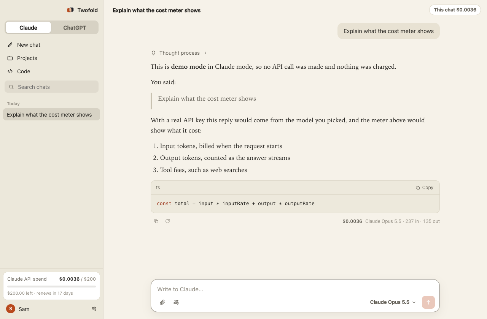
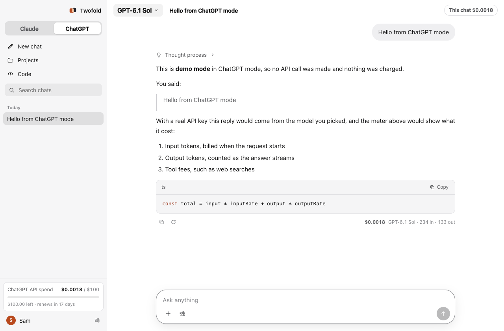
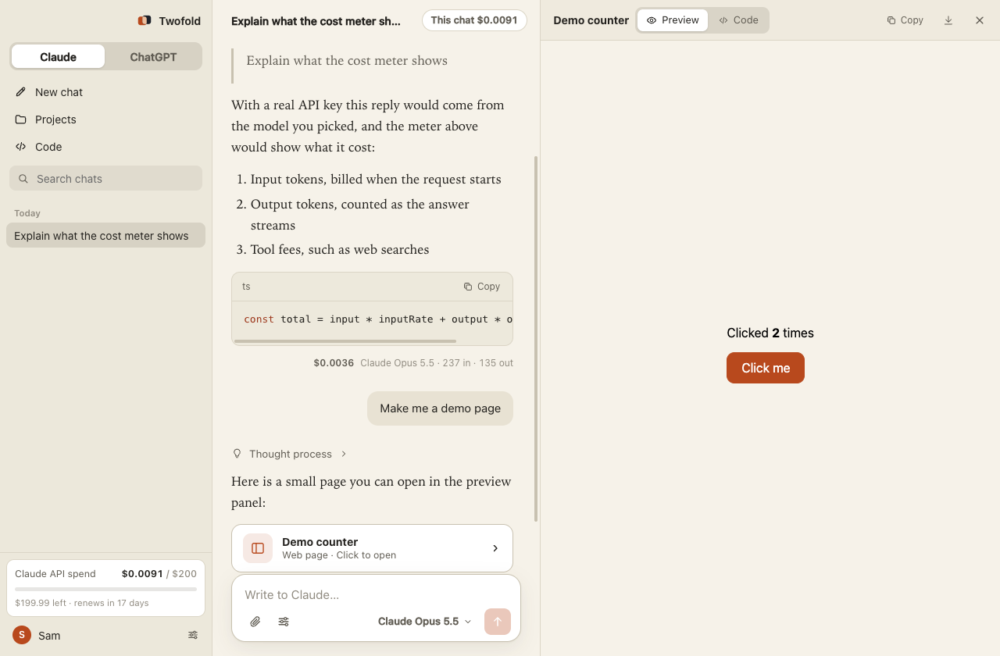
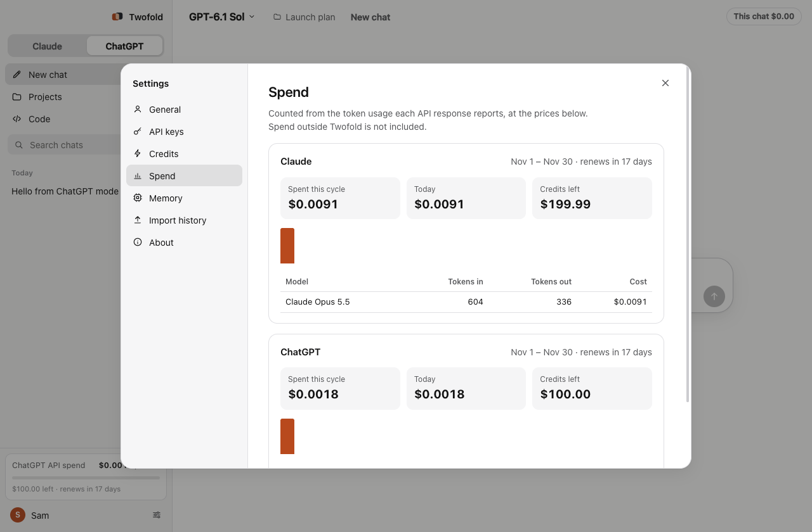

<p align="center"></p>

# Twofold

**Two assistants. One local app. Your own API credits.**

Twofold is a desktop app for macOS with a Claude mode and a ChatGPT mode. It talks to the Anthropic and OpenAI APIs directly from your computer with your own API keys, and it shows what every message costs while the reply is still being written.

It exists because paid Claude and ChatGPT plans now include monthly API credits that the official apps cannot spend. Twofold gives those credits somewhere to go.

> Twofold is an independent project. It is not made by, affiliated with or endorsed by Anthropic or OpenAI. "Claude" and "ChatGPT" are trademarks of their owners and are used only to say which API a mode connects to.



## What it does

| | Claude mode | ChatGPT mode |
|---|---|---|
| Chat with streaming, model picker, thinking | Yes | Yes |
| Images, PDFs and text files in a message | Yes | Yes |
| Web search | Yes | Yes |
| Code execution with data files and generated charts | Yes | Yes |
| Image generation | No | Yes |
| Live preview panel for pages and SVGs the model writes | Yes | Yes |
| Projects (instructions and reference files) | Yes | Yes |
| Memory across chats | Yes, shared by both modes | Yes, shared by both modes |
| Coding agent in a project folder | Claude Agent SDK | Twofold's own agent on the OpenAI API |
| Import history from the official app's data export | Yes | Yes |

Not included: voice, the official apps' connectors, and syncing chats back to the official apps.

| ChatGPT mode | Preview panel |
|---|---|
|  |  |

Screenshots are from demo mode, which is why the replies describe themselves as canned.

### Cost, live

- Every reply shows its cost under it, with the model and token counts.
- The top bar shows the running total for the open chat. It ticks up while the reply streams (marked "≈") and settles to the exact figure when the API reports the final token counts.
- The sidebar shows this billing cycle's spend against your monthly credit grant, and how many days until it renews.
- Settings → Spend breaks it down by model and by day.



## Setup

Requirements: macOS 13 or later, Node.js 22 or later, pnpm 10.

```bash
pnpm install
```

```bash
pnpm dev
```

The first launch opens a short wizard. For each mode you want:

1. **Claim your monthly API credits**, if your plan has them. In the official app go to Settings → Billing → API credits and link an API organization. The plan must be at least seven days old.
   - Claude: Max ($100), Ultra ($200) and Team plans. [Anthropic's guide](https://support.claude.com/en/articles/17154008-monthly-api-credits-for-max-ultra-and-team-plans)
   - ChatGPT: Pro ($100, $200 or $500) and Business plans. [OpenAI's guide](https://help.openai.com/en/articles/20001626-api-credits-benefit-for-eligible-chatgpt-subscriptions)
2. **Create an API key** in that same organization: [Claude Console](https://platform.claude.com/settings/keys) or [OpenAI API Platform](https://platform.openai.com/api-keys).
3. **Paste the key into Twofold.** It is checked with a free request and stored encrypted.

Without plan credits everything still works; usage is billed to the payment method on your API account.

To try the interface without any key:

```bash
pnpm demo
```

Demo mode makes no network calls and costs nothing. Replies are canned.

### Importing your history

In the official app choose Settings → Export data. You get an email with a ZIP. In Twofold open Settings → Import history and pick the ZIP; no need to unzip it. Imported chats can be continued through the API.

The export is a snapshot: images and uploaded files are not in it, and chats continued in Twofold do not sync back.

## Build a Mac app

```bash
pnpm dist
```

This produces `dist/mac-arm64/Twofold.app`, unsigned. To open an unsigned app the first time, right-click it and choose Open.

## How cost is calculated

Twofold multiplies the token counts each API response reports by the prices in [`src/shared/pricing.ts`](src/shared/pricing.ts), which were copied from the providers' public pricing pages on the date recorded in that file. Web search adds $0.01 per search on both APIs.

Things to know:

- **Twofold cannot read your real credit balance.** The meter counts what Twofold itself spent. Usage from other tools on the same API organization is not included.
- **Prices change.** If a provider changes a price, update `pricing.ts`. A model that is not in the table shows "cost unknown" and is not counted.
- **Estimates are marked.** While a reply streams, output tokens are estimated from text length. In Claude mode the input cost is exact from the first moment; in ChatGPT mode the whole figure is an estimate until the reply ends. A reply you stop early keeps its estimate.
- **Not counted:** OpenAI image generation, Anthropic code-execution container time beyond its free allowance, and OpenAI long-context pricing above 272K prompt tokens (flagged with a "+" when it applies). OpenAI's code sandbox is counted at $0.03 per 20-minute session, which is an approximation.
- **Long chats cost more per message.** Each request resends the conversation. Prompt caching is on, which cuts the cost of the repeated part to a small fraction, but it still grows.

## Privacy and security

- No Twofold server, account or telemetry. Requests go from your computer to `api.anthropic.com` and `api.openai.com` and nowhere else.
- API keys are encrypted with Electron `safeStorage`, which keeps its encryption key in the macOS Keychain.
- Chats, projects, memory and the spend ledger are plain JSON files in `~/Library/Application Support/Twofold/data`.
- OpenAI requests are sent with `store: false`, so OpenAI does not keep them as stored responses. Each provider's normal API data policies still apply.
- The window runs sandboxed with context isolation. Pages the model writes are previewed in a sandboxed frame with no access to the app.
- The coding agents can read the project folder you choose. They ask before every file edit and every shell command, and the ChatGPT-mode agent cannot touch paths outside that folder.

## Development

```bash
pnpm typecheck
```

```bash
pnpm test:run
```

```bash
pnpm test:e2e
```

| Path | What is there |
|---|---|
| `src/main/providers/` | The two chat providers, the live cost meter and a demo provider |
| `src/main/code/` | The two coding agents and their file and shell tools |
| `src/main/importers.ts` | Parsers for the ChatGPT and Claude data exports |
| `src/main/store.ts` | Local JSON storage and the spend ledger |
| `src/shared/pricing.ts` | Price table and cost maths |
| `src/renderer/` | The React interface |
| `brand/` | Logo, icon and the brand guide |

## What has and has not been tested

Tested: the price maths, export parsers, storage, file-tool path confinement and the cost meter (unit tests), and the whole interface end to end in demo mode (wizard, both modes, live cost, preview panel, projects, memory, spend, dark theme).

**Not yet tested against the real APIs.** The provider code was written against the official SDK type definitions and documentation and compiles against them, but no request with a real key has been made. Expect to find and fix issues on first real use, most likely around tool results, file uploads and the coding agents.
